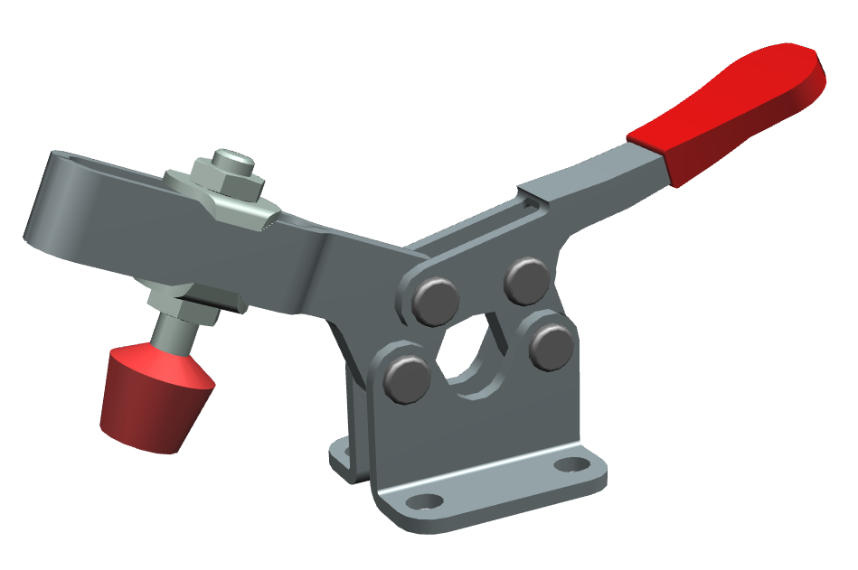
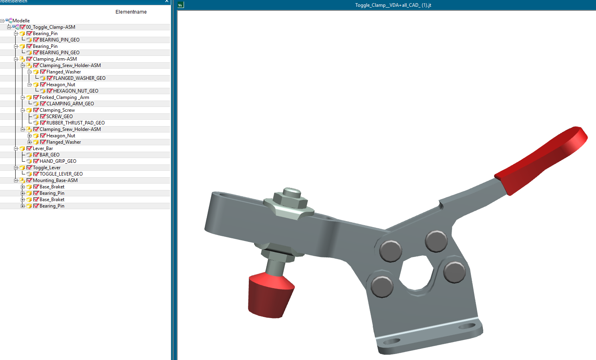

Wie lassen sich CAD-Daten, einzelne Bauteile, reale Prüflinge und die dazugehörigen Prüfergebnisse digital miteinander verknüpfen? Ein neues Beispiel anhand eines realen CAD-Datensatzes veranschaulicht diesen Zusammenhang. Anhand einer kompletten Baugruppe, die gemäß VDA 231-300 mit den MAT- und SUR-Attributen bedatet ist, wird die gesamte Informationskette durchgängig gezeigt. Zugleich wird die Grundlage für die Verknüpfung mit menschenlesbaren Prüfberichten im PDF/A-Format gelegt.

*Toggle Clamp als Anwendungsbeispiel für die Verknüpfung von Komponenten-, Material- und Prüfinformationen mit VDA 231-301.*

Das Beispiel bildet eine "Toggle Clamp", einen Kniehebelspanner, mit ihrer Komponentenstruktur ab. Die Baugruppe beinhaltet mehrere Subkomponenten, die ihrerseits wieder Subkomponenten haben. Die Baugruppe enthält auch mehrere Gleichteile, etwa die Bearing Pins, die sich nur in ihrer Einbauposition unterscheiden. Material und Eigenschaften werden deshalb nur einmal an der Komponente beschrieben, und die Vorkommen in den CAD-Daten verweisen auf diese Beschreibung. So muss nichts doppelt gepflegt werden, und jede Position bleibt trotzdem eindeutig zuordenbar. Hinzu kommen verschiedene Werkstoffarten wie Metalle und Polymere. Damit eignet sich die Baugruppe gut, um zu prüfen, ob VDA 231-301 auch komplexe reale Strukturen abbilden kann.

 
*Baugruppenstruktur der Toggle Clamp: Unterbaugruppen, Gleichteile wie die Bearing Pins und Geometrieknoten, die mit den Komponenten in VDA 231-301 verknüpft werden.*

In diesem Beispiel geht es im Kern nicht allein um die Beschreibung eines Materials oder eines Prüfergebnisses, sondern um den strukturierten, interoperablen Austausch von Material- und Prüfinformationen auf Basis der VDA 231-301. Die Modellierung unterscheidet dabei unter anderem zwischen Komponenten und konkreten physischen Instanzen.

> **CAD-Modell → Komponente → physisches Prüfobjekt → Prüfung → strukturiertes Ergebnis → lesbarer Prüfbericht**

## Von der CAD-Komponente zum Prüfling

Das Toggle-Clamp-Beispiel zeigt die Verbindung mehrerer Informationsebenen: Die Baugruppenstruktur wird digital beschrieben und einzelne Komponenten werden mit ihren Vorkommen in den CAD-Daten verknüpft. Daneben können konkrete physische Prüfobjekte und die zugehörigen Prüfungen abgebildet werden.

Für die metallischen Komponenten dienen Zug- und Härteprüfungen als Beispiele. Es wird gezeigt, wie Prüfobjekt, Prüfkörper, Testausführung und Ergebnisse sich innerhalb des strukturierten Datenmodells miteinander in Beziehung setzen lassen. Somit können Material- und Prüfinformationen strukturiert und maschinenlesbar zwischen unterschiedlichen Beteiligten und IT-Systemen ausgetauscht werden.

## Weitere Prüfungen machen das Beispiel greifbarer

Die Toggle Clamp wird um weitere beispielhafte Prüfinformationen für Polymere ergänzt. Dazu gehören beispielsweise Ergebnisse für die Subkomponenten Rubber Thrust Pad und Hand Grip. Eine Geruchsprüfung nach VDA 270 zeigt dabei exemplarisch, wie sich auch werkstoffspezifische Prüfungen für Polymere abbilden lassen. Für ein Spannwerkzeug ist diese Prüfung fachlich nicht typisch, sie dient hier nur der Demonstration.

Außerdem werden Daten aus Abnahmeprüfzeugnissen 3.1 nach EN 10204 sowie Werkstoffkennwerte nach SEP 1240 über die vorhandenen Subschemata abgebildet.

## Der nächste Schritt: strukturierte Daten und PDF/A zusammenbringen

Ein strukturierter JSON-Datensatz ist für die maschinelle Verarbeitung geeignet. Im betrieblichen Austausch werden Prüfergebnisse jedoch häufig zusätzlich in einer unmittelbar lesbaren Dokumentform benötigt.

Hier setzt das derzeit als **Working Draft** vorliegende VDA-231-301-PDF-Package-Konzept an. Es beschreibt einen PDF/A-basierten Transportcontainer, der einen lesbaren Report mit einem Manifest sowie strukturierten Daten und optionalen weiteren Dateien zusammenführen kann.

Der derzeit dokumentierte Manifest Contract hat den Stand **Draft 0.1.0**. Dabei handelt es sich ausdrücklich noch nicht um eine freigegebene Spezifikation.

Das Manifest stellt die Zuordnung der enthaltenen Dateien her. Nach dem aktuellen Working Draft umfasst ein Package:

- einen menschenlesbaren Report,
- ein Manifest,
- genau einen Main-JSON-Payload,
- optional weitere Subdocuments,
- optional binäre Attachments.

Das Beispiel macht damit sichtbar, wie technische Daten aus unterschiedlichen Informationswelten miteinander in Beziehung gesetzt werden können, ohne den menschenlesbaren Prüfbericht durch reine Maschinendaten zu ersetzen.

## Transparenz zum aktuellen Stand

Das Toggle-Clamp-Beispiel dient der Demonstration von Modellierung und Datenaustausch. Baugruppenstruktur und CAD-Daten stammen aus einem realen Datensatz. Die technischen und organisatorischen Angaben sowie die Prüfergebnisse sind dagegen illustrativ und beschreiben kein tatsächlich geprüftes Bauteil.

Das vollständige Beispiel mit allen JSON-Dateien findet sich im [VDA 231-301 Repository](https://github.com/VDA231-301/VDA231-301/tree/main/examples/clamp).
Feedback und Anmerkungen sind als [Issue](https://github.com/ORGANISATION/REPO/issues) willkommen.

Das PDF/A-Package ist aktuell als **Working Draft** einzuordnen. 

## Der nächste Schritt: strukturierte Daten und PDF/A zusammenbringen

Ein strukturierter JSON-Datensatz ist für die maschinelle Verarbeitung geeignet. Im betrieblichen Austausch werden Prüfergebnisse jedoch häufig zusätzlich in einer unmittelbar lesbaren Dokumentform benötigt.

Hier setzt das derzeit als **Working Draft** vorliegende VDA-231-301-PDF-Package-Konzept an. Es beschreibt einen PDF/A-basierten Transportcontainer, der einen lesbaren Report mit einem Manifest sowie strukturierten Daten und optionalen weiteren Dateien zusammenführen kann.

Der derzeit dokumentierte Manifest Contract hat den Stand **Draft 0.1.0**. Dabei handelt es sich ausdrücklich noch nicht um eine freigegebene Spezifikation.

Das Manifest stellt die Zuordnung der enthaltenen Dateien her. Nach dem aktuellen Working Draft umfasst ein Package:

- einen menschenlesbaren Report,
- ein Manifest,
- genau einen Main-JSON-Payload,
- optional weitere Subdocuments,
- optional binäre Attachments.

Das Beispiel macht damit sichtbar, wie technische Daten aus unterschiedlichen Informationswelten miteinander in Beziehung gesetzt werden können, ohne den menschenlesbaren Prüfbericht durch reine Maschinendaten zu ersetzen.

## Transparenz zum aktuellen Stand

Das Toggle-Clamp-Beispiel dient der Demonstration der Modellierung und des Datenaustauschs. Die in den Beispielen verwendeten technischen und organisatorischen Angaben sowie Prüfergebnisse sind illustrativ.

Das PDF/A-Package ist aktuell als **Working Draft** einzuordnen. 

